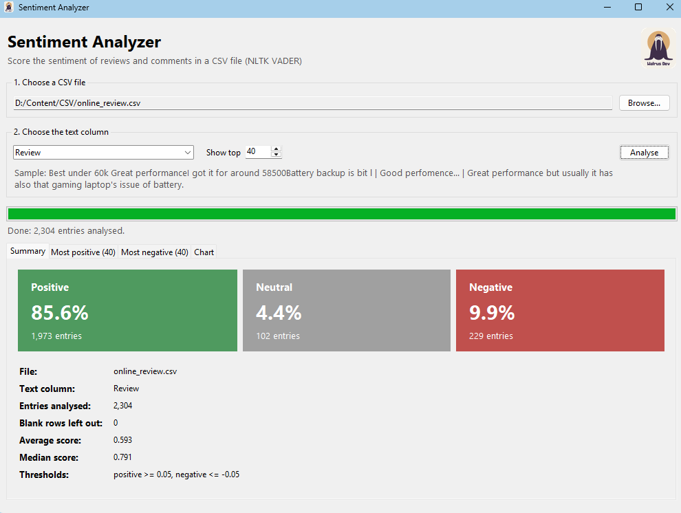
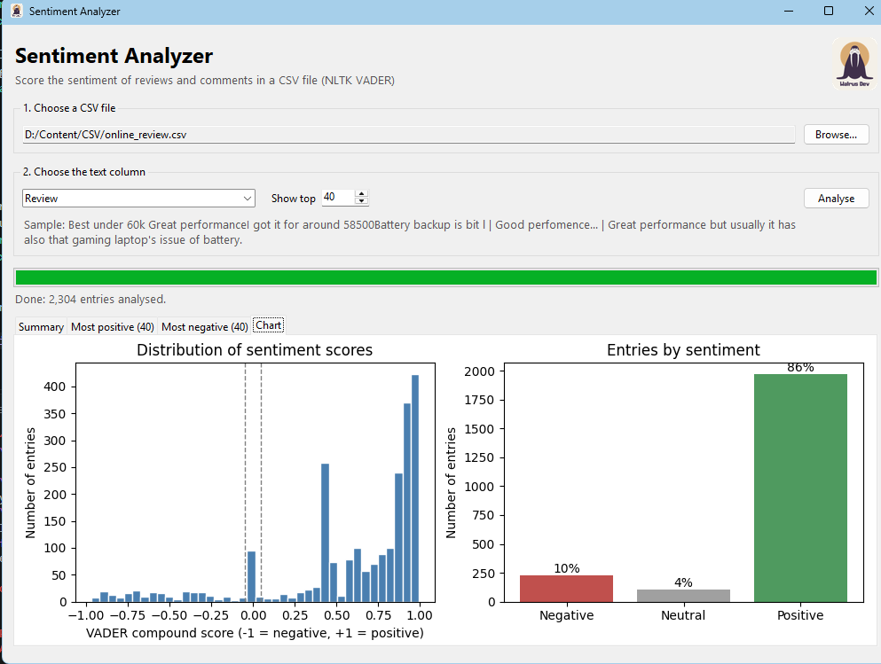

<div align="center">


# Sentiment Analyzer

**Score the sentiment of reviews, comments or any text in a CSV file, in seconds.**

[](https://github.com/marcus2045/Sentiment-Analysis/releases/latest)
[](https://www.python.org/)
[](https://github.com/marcus2045/Sentiment-Analysis/releases/latest)
[](LICENSE)

[**⬇ Download for Windows**](https://github.com/marcus2045/Sentiment-Analysis/releases/latest) · [Features](#features) · [How it works](#how-it-works) · [Run from source](#run-from-source)

</div>

---

Sentiment Analyzer reads a CSV file, such as Steam reviews, Amazon reviews or survey answers, and scores every entry from **-1 (very negative)** to **+1 (very positive)** using **VADER** from the Natural Language Toolkit (NLTK). It shows you the most positive and most negative entries, a summary of the overall mood, and a chart, then lets you save the results for Excel or Power BI.

## Screenshots

<div align="center">


</div>

## Features

| | |
| --- | --- |
| 🖥️ **Desktop app** | A simple window: browse for a file, pick a column, click Analyse. No coding needed. |
| 📂 **Handles messy CSVs** | Tries common text encodings (UTF-8, Windows-1252, Latin-1) and reports any broken rows it skips. |
| 🎯 **Smart column picker** | Guesses which column holds the text and shows a sample so you can check. |
| 🏆 **Top and bottom entries** | The most positive and most negative entries, ranked, with a full-text view. |
| 📊 **Summary and charts** | Positive, neutral and negative percentages, average and median score, a score histogram and a bar chart. |
| 💾 **Export** | Save the scored data as a CSV (score + label on every row) and the chart as a PNG. |
| 📴 **Works offline** | The Windows app comes with everything it needs bundled in. |

## Download

1. Go to the [**latest release**](https://github.com/marcus2045/Sentiment-Analysis/releases/latest).
2. Download **`Sentiment Analyzer.exe`**.
3. Double-click it. No installation is needed.

> Windows may show a "Windows protected your PC" message the first time, because the app isn't signed. Click **More info → Run anyway**.

## How it works

VADER gives each piece of text a **compound score** between -1 and +1:

| Compound score | Label |
| --- | --- |
| 0.05 or higher | 🟢 Positive |
| Between -0.05 and 0.05 | ⚪ Neutral |
| -0.05 or lower | 🔴 Negative |

VADER is built for short, informal text. It understands capital letters ("GREAT"), exclamation marks, emojis, and words that change meaning, like "not good" or "very good".

## Run from source

```bash
git clone https://github.com/marcus2045/Sentiment-Analysis.git
cd Sentiment-Analysis
pip install -r requirements.txt
```

**Desktop app:**

```bash
python gui.py
```

**Command-line version:**

```bash
python main.py
```

Enter the path to a CSV file, choose the text column, and the results are printed and saved next to your file as `<file>_sentiment.csv` and `<file>_sentiment_chart.png`.

The VADER word list downloads automatically on first run.

## Build the .exe yourself

On Windows, run **`build.bat`** from the project folder. It installs PyInstaller, bundles the VADER word list so the app works offline, and creates `dist\Sentiment Analyzer.exe` with the Walrus Dev icon.

## Test data

Tested with public Kaggle datasets of **Steam game reviews** and **Amazon product reviews**. Download either as a CSV file and open it in the app.

## Built with

[Python](https://www.python.org/) · [NLTK (VADER)](https://www.nltk.org/) · [pandas](https://pandas.pydata.org/) · [matplotlib](https://matplotlib.org/) · Tkinter · [PyInstaller](https://pyinstaller.org/)

## License

Released under the [MIT License](LICENSE).

<div align="center">
<sub>Made by <a href="https://github.com/marcus2045">Walrus Dev</a></sub>
</div>
